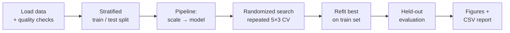
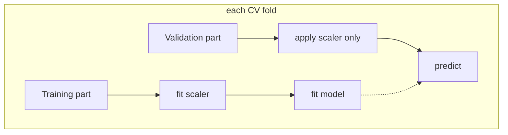
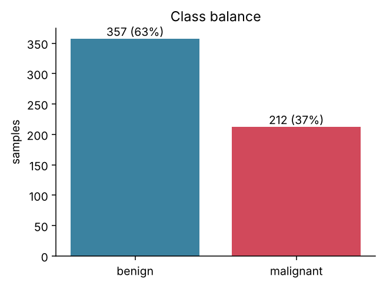
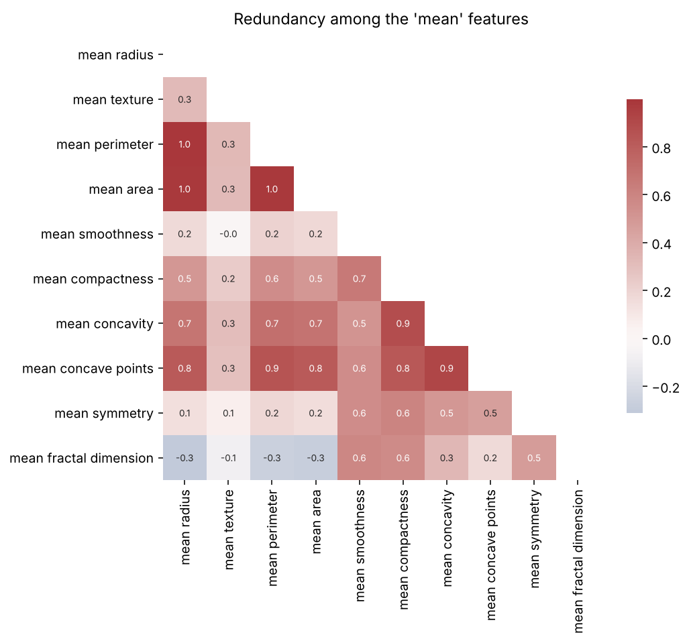
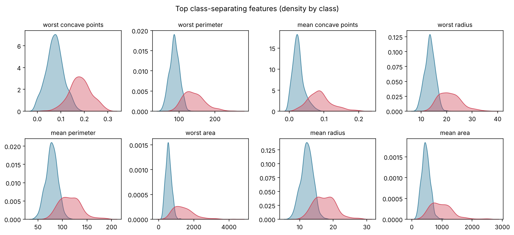
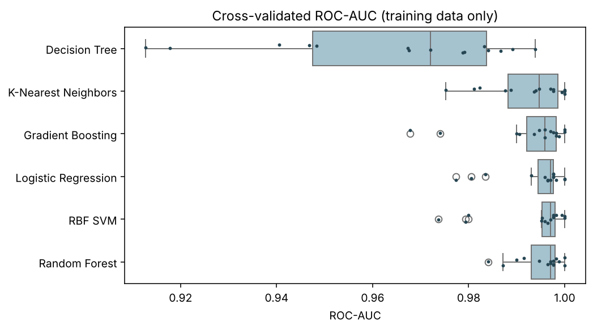
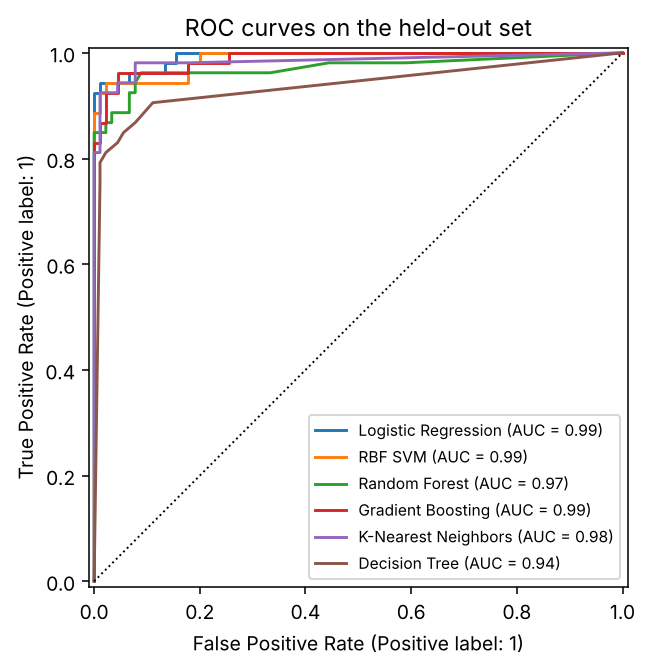
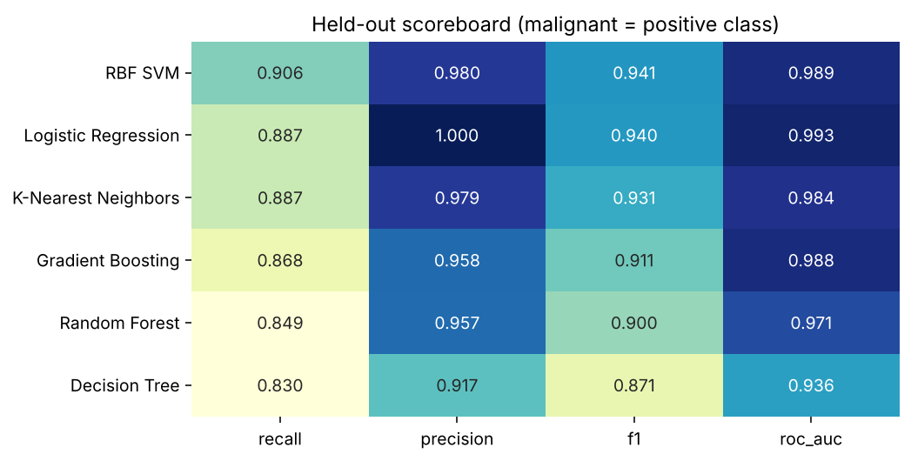
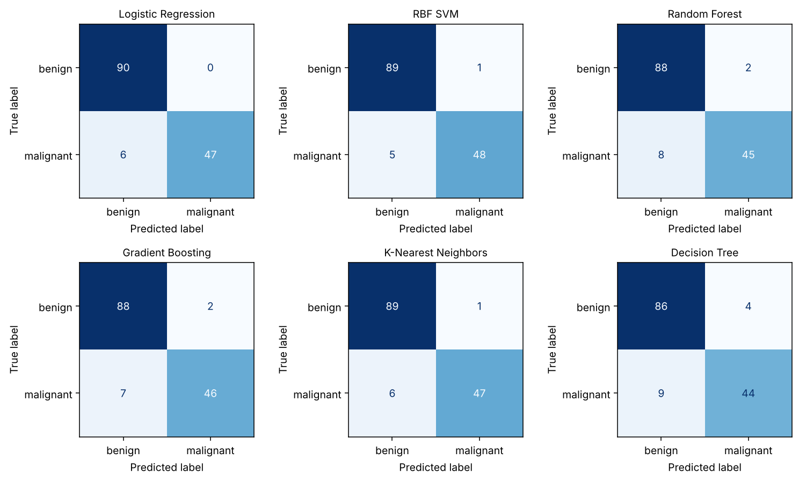
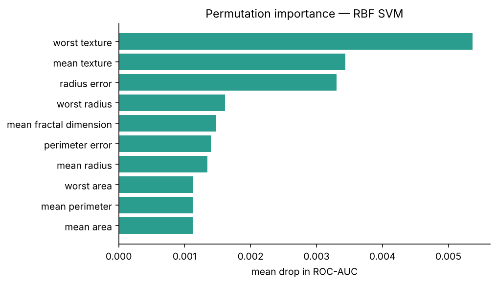

# Breast Cancer Model Comparison

A compact, reproducible study that compares six classical machine-learning models for separating **malignant** from **benign** tmors using the public Wisconsin diagnostic dataset (569 samples, 30 numeric measurements). The emphasis is on *leakage-safe pipelines* and *error-aware metrics* (recall on the malignant class) rather than plain accuracy

> Educational project only — not a medical device

---

## Highlights
| Aspect | Approach |
|---|---|
| Positive class | **Malignant** (labels flipped once, in `data.py`) |
| Leakage control | `StandardScaler` inside each `Pipeline` |
| Tuning | `RandomizedSearchCV` on repeated stratified K-fold, scored by ROC-AUC |
| Models | Logistic Regression · RBF SVM (calibrated) · Random Forest · Gradient Boosting · k-NN · Decision Tree |
| Metrics | Recall, precision, F1, ROC-AUC, PR-AUC, raw FN/FP counts |
| Interpretation | Permutation importance on held-out data (works for every model) |

## Workflow


### Why the pipeline matters


## Project layout
```
tumor-classifier/
├── run_experiment.py        # one command: tune, evaluate, draw figures
├── requirements.txt
├── src/tumorclf/
│   ├── config.py            # seed, split size, CV settings
│   ├── data.py              # loading, label convention, sanity checks
│   ├── models.py            # pipelines + search spaces
│   ├── evaluation.py        # metrics, permutation importance
│   └── plots.py             # figure factory
├── notebooks/walkthrough.ipynb
├── docs/figures/            # generated PNGs used below
└── reports/                 # holdout_results.csv, summary.json
```

## Quick start
```bash
python -m venv .venv && source .venv/bin/activate
pip install -r requirements.txt
python run_experiment.py          # regenerates docs/figures and reports/
jupyter notebook notebooks/walkthrough.ipynb
```
Settings (seed, test fraction, CV folds/repeats, search budget) live in `src/tumorclf/config.py`

## Results gallery

### Data exploration
| Class balance | Redundant features |
|---|---|
|  |  |



### Model selection


### Held-out performance
| ROC curves | Scoreboard |
|---|---|
|  |  |



### Interpretation


## Findings
Held-out set = 143 samples (53 malignant). Seed 7, default 0.5 threshold.

| Model | Recall | Precision | ROC-AUC | Missed malignant |
|---|---|---|---|---|
| RBF SVM | 0.906 | 0.980 | 0.989 | 5 |
| Logistic Regression | 0.887 | 1.000 | 0.993 | 6 |
| k-NN | 0.887 | 0.979 | 0.984 | 6 |
| Gradient Boosting | 0.868 | 0.958 | 0.988 | 7 |
| Random Forest | 0.849 | 0.957 | 0.971 | 8 |
| Decision Tree | 0.830 | 0.917 | 0.936 | 9 |

* Scaled linear and kernel models are as good as or better than tree ensembles on this small, smooth dataset
* A single decision tree is clearly the weakest and the least stable across folds
* Differences among the top four are only a few samples, so treat the ranking as indicative, not definitive
* Every model still misses some malignant cases at the default threshold; a screening use case would lower the threshold and accept more false alarms

## Design choices
* **Malignant = 1** so "recall" answers the question that matters: *how many cancers did we catch?*
* **ROC-AUC for tuning** keeps model selection independent of the decision threshold.
* **Repeated CV** reduces the variance of a 455-row training set
* **Calibrated SVM** gives usable probabilities without the deprecated `probability=True` path